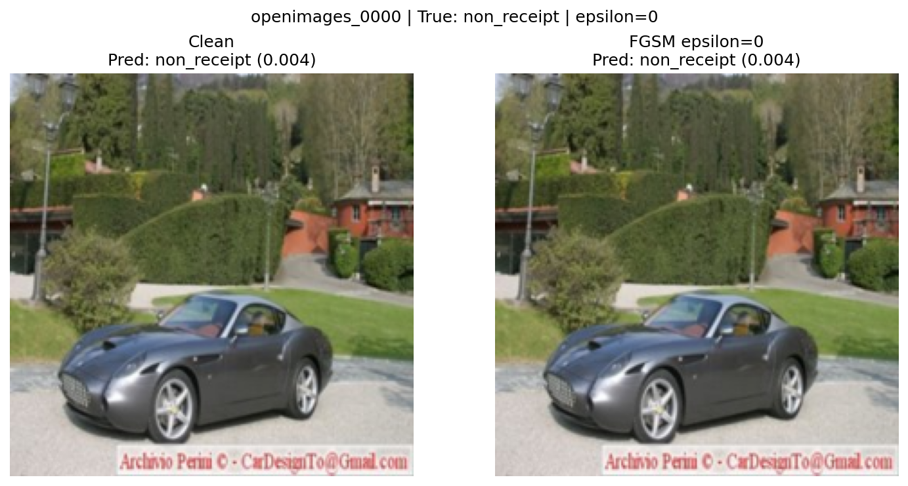
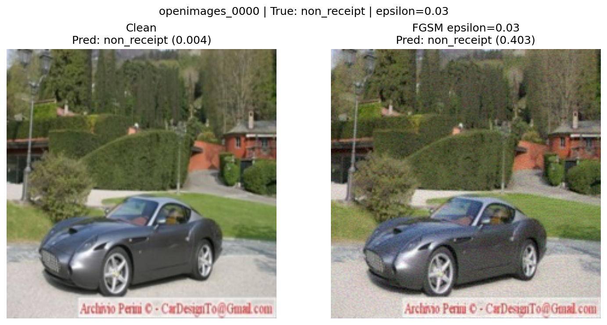
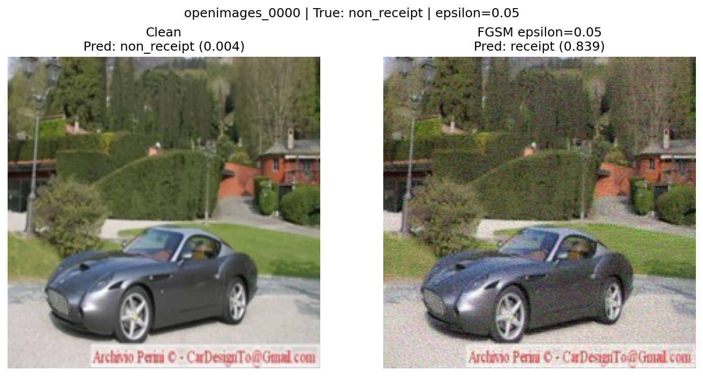
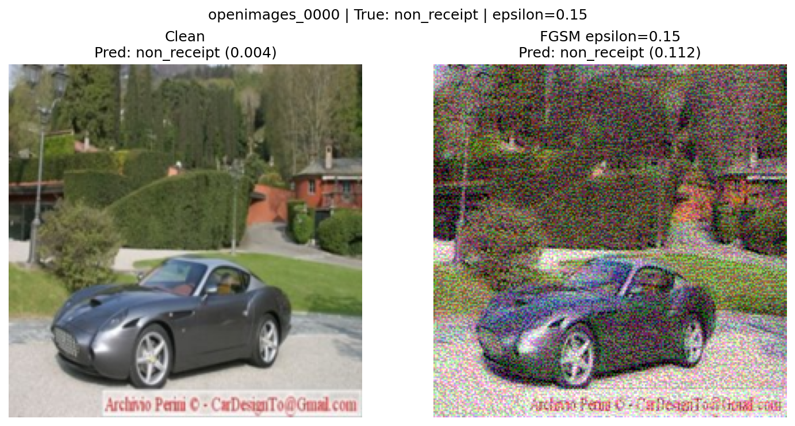

# FGSM Evasion Attack Results

## Clean Model Baseline

Measured with `evaluate.py --model-path checkpoints/receipt_cnn_clean.pt
--test-dir balanced_data/test` on the untouched 390-image test set
(195 receipt / 195 non_receipt).

- **Model:** ReceiptCNN
- **Test accuracy:** 0.9436 (94.36%)
- **Precision:** 0.9943 | **Recall:** 0.8923 | **F1:** 0.9405
- **Confusion matrix:** `[[194, 1], [21, 174]]` (rows = true `non_receipt` /
  `receipt`) — the clean model almost never calls a non-receipt a receipt
  (1 false positive) but misses 21 real receipts.
- **FGSM baseline (ε = 0.000):** adversarial accuracy is **0.9436**, identical
  to the clean baseline, and the ε=0.000 adversarial image is pixel-identical to
  the clean image. This confirms the degradation at higher ε comes from the
  perturbation itself and not from the evaluation loop.

## FGSM Results

Run with `python 01_fgsm_evasion.py`
(`attacks/results/01_fgsm/fgsm_results.json`). "Clean Accuracy" is the model's
accuracy on the unperturbed input; "Adversarial Accuracy" is accuracy after the
FGSM perturbation; "Attack Success Rate" is the fraction of originally-correct
predictions that were flipped to wrong.

| Epsilon | Clean Accuracy | Adversarial Accuracy | Attack Success Rate |
|---------|---------------|---------------------|-------------------|
| 0.000 | 0.9436 | 0.9436 | 0.0000 |
| 0.010 | 0.9436 | 0.8077 | 0.1440 |
| 0.030 | 0.9436 | 0.5103 | 0.4592 |
| 0.050 | 0.9436 | 0.3000 | 0.6821 |
| 0.100 | 0.9436 | 0.2718 | 0.7120 |
| 0.150 | 0.9436 | 0.4462 | 0.5272 |

Accuracy degrades steadily from 94% to ~27% as ε grows from 0 to 0.10. The slight
**recovery at ε = 0.15** (back up to 0.4462) is expected FGSM behavior: a very
large single step overshoots, and pixel clamping to [0,1] saturates large regions
of the image, which pushes some samples back across the decision boundary. The
attack is most effective in the 0.05–0.10 range.

## Visual Evidence

The same test sample (`openimages_0000`, a true `non_receipt` — a photo of a car)
is used at every ε so the comparison is meaningful. For this sample the model
prediction climbs 0.004 → 0.052 → 0.403 → **0.839 (flips to receipt)** → 0.889 →
0.112, i.e. it flips at ε = 0.05 and flips back at ε = 0.15.

At ε = 0.000 the two panels are identical; prediction unchanged (non_receipt,
0.004). Pure control case.

At ε = 0.010 the perturbation is **imperceptible** — the images look identical to
a human — yet across the full test set accuracy has already dropped from 94% to
81%.

At ε = 0.030 only a very faint grain is visible on close inspection; the image is
still clearly a car to a human. Fleet accuracy has collapsed to ~51% (coin-flip),
and this sample's score has climbed to 0.403 — right at the edge of flipping.

At ε = 0.050 noise becomes **noticeable** but the subject is still obvious. This
is where this sample flips (0.839 → receipt) and fleet accuracy hits 30%.

At ε = 0.100 the perturbation is **blatant** — heavy rainbow speckle over the
whole frame — and the model is confidently wrong (receipt, 0.889). A human
reviewer would immediately flag this image as tampered.

At ε = 0.150 the image is severely degraded, but the oversized step + clamping
has pushed this particular sample back to non_receipt (0.112), illustrating the
non-monotonic recovery seen in the table.

## Analysis

1. **At what epsilon does accuracy drop below 50%?** Between ε = 0.03
   (adversarial accuracy 0.5103, essentially a coin flip) and ε = 0.05 (0.3000).
   The first value clearly below 50% is at ε = 0.05.
2. **How do you interpret the attack success rate?** It is the share of
   originally-correct predictions the attacker managed to flip. It rises from 14%
   (ε=0.01) to a peak of **71%** (ε=0.10), then falls as the perturbation grows
   so large that clamping undoes some flips. So at ε=0.10 roughly 7 in 10
   correctly-classified images can be forced to the wrong class.
3. **Would these perturbations be visible to a human?** The most dangerous ones
   are **not**. At ε = 0.01 the change is invisible yet accuracy already falls to
   81%; at ε = 0.03 it is a barely-there grain while accuracy reaches a coin
   flip. The model starts failing *well before* a human reviewer would notice
   anything — exactly the regime an attacker wants. Only at ε ≥ 0.05–0.10 does
   the noise become obvious.
4. **Implications for the expense system.** An attacker who can submit images
   (expense receipts) can craft near-invisible perturbations that make the
   classifier accept a non-receipt as a valid receipt (or vice versa), defeating
   automated expense screening without tripping a human reviewer. Mitigations:
   adversarial training, input preprocessing/denoising (e.g. JPEG re-compression,
   bit-depth reduction), randomized smoothing, confidence thresholds with human
   review on low-margin cases, and not treating the classifier's output as
   sufficient on its own for approval.
