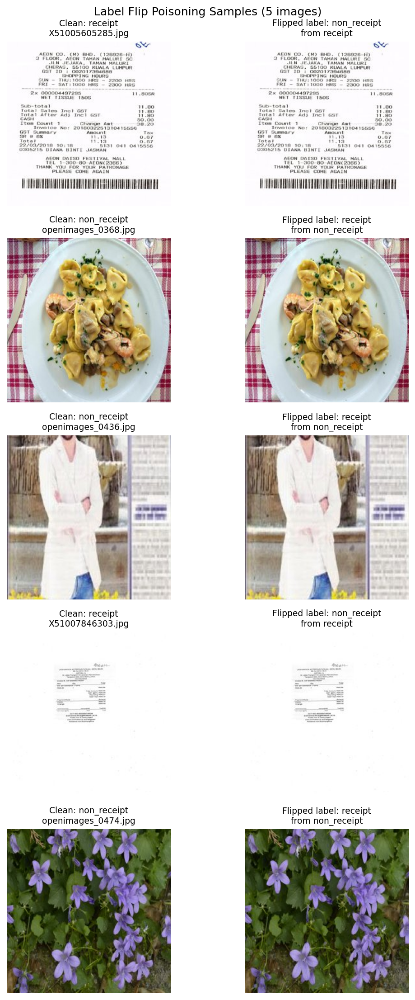
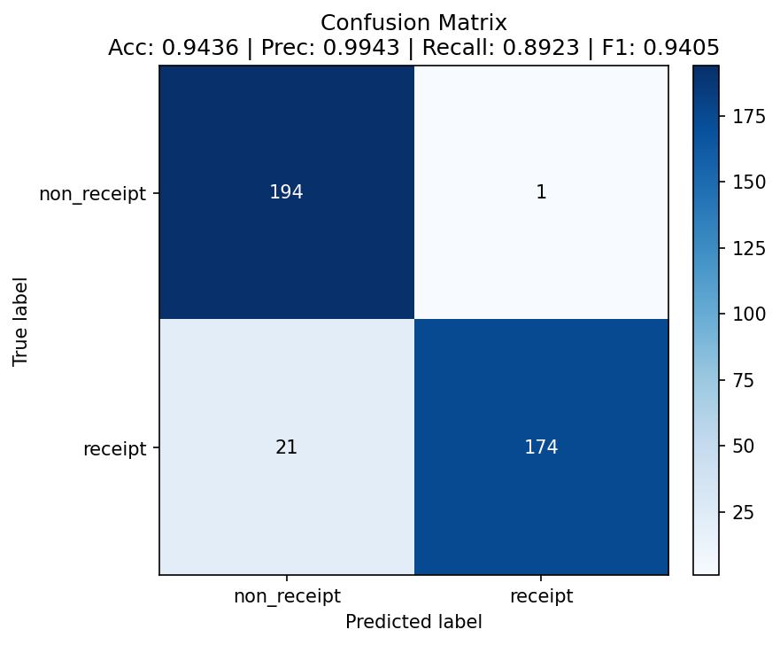
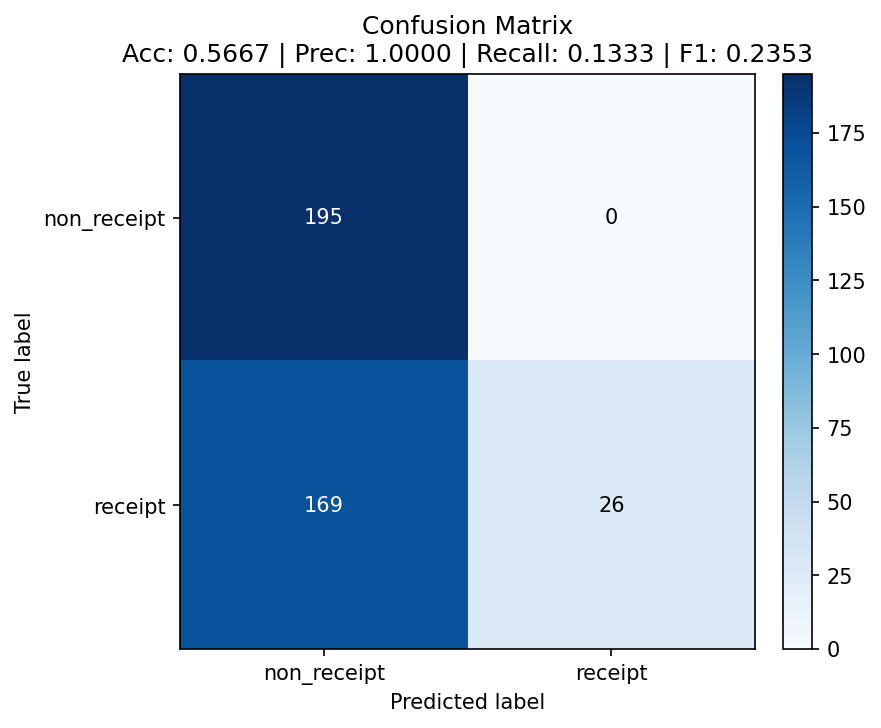

# Data Poisoning Results

## Attack Configuration

- **Method:** Label-flip poisoning (images moved between class folders; only the
  training split is touched, the test set is left clean).
- **Flip rate:** 0.10 (10%, the maximum allowed)
- **Labels flipped:** 114 out of 1,154 training images (9.88% — 57 receipt→
  non_receipt and 57 non_receipt→receipt). Per-class folder counts stay balanced
  (577/577) because the swap is symmetric.
- **Goal:** Demonstrate that corrupting a small, realistic fraction of training
  labels shifts the learned decision boundary enough to badly degrade accuracy
  on otherwise-clean evaluation data — a training-time integrity attack that is
  invisible at inference time.

## Label Flip Evidence

The figure pairs each poisoned training image (right) with its clean source
(left). The **pixels are identical** in every pair — a genuine receipt
(`X51005605285.jpg`) now carries the label `non_receipt`, and photos of food, a
person, and flowers now carry the label `receipt`. The attack changes *labels
only*, never pixel content, which is exactly what makes it hard to spot by
eyeballing the images: the corruption lives in the folder/label, not the data.

## Baseline (Clean Model)

`evaluate.py --model-path checkpoints/receipt_cnn_clean.pt` on `balanced_data/test`.

| Metric | Value |
|--------|-------|
| Accuracy | 0.9436 |
| Precision | 0.9943 |
| Recall | 0.8923 |
| F1 Score | 0.9405 |

Confusion matrix `[[194, 1], [21, 174]]` (rows = true `non_receipt` / `receipt`).

## Poisoned Model

Retrained with `train.py --data-dir poisoned_data --checkpoint-name
receipt_cnn_poisoned.pt`, evaluated on the **same clean test set**.

| Metric | Value |
|--------|-------|
| Accuracy | 0.5667 |
| Precision | 1.0000 |
| Recall | 0.1333 |
| F1 Score | 0.2353 |

Confusion matrix `[[195, 0], [169, 26]]` (rows = true `non_receipt` / `receipt`).

## Impact Analysis

| Metric | Clean | Poisoned | Change |
|--------|-------|----------|--------|
| Accuracy | 0.9436 | 0.5667 | **−0.3769 (−37.7 pp)** |
| Precision | 0.9943 | 1.0000 | +0.0057 |
| Recall | 0.8923 | 0.1333 | **−0.7590** |
| F1 | 0.9405 | 0.2353 | **−0.7052** |

## Confusion Matrices (Optional)

## Key Findings

1. **How significant is the accuracy drop?** Very. Accuracy fell from 94.36% to
   56.67% — a **37.7 percentage-point** drop, more than seven times the 5-point
   threshold — from a corruption of under 10% of training labels. Barely above a
   coin flip on a balanced test set.

2. **Which class was more affected and why?** The **receipt** (positive) class
   was devastated: recall collapsed from 0.8923 to **0.1333**. The poisoned model
   now labels almost everything `non_receipt` — it correctly keeps all 195 true
   non-receipts but misclassifies 169 of 195 real receipts. Precision rose to
   1.0 only because the model became so conservative that the 26 images it still
   dares to call "receipt" happen to all be receipts. The reason is that the
   flipped `non_receipt→receipt` images injected varied, structureless photos
   (food, people, flowers) into the receipt class while flipped
   `receipt→non_receipt` images pulled genuine receipt features (printed text,
   barcodes, tabular layout) into the negative class. This blurs the very
   features that define a receipt, so the cheapest low-loss solution the model
   finds under 15 epochs + aggressive augmentation is to default to
   `non_receipt`. The symmetric 50/50 flip did **not** produce a symmetric
   effect — the positive class, which depends on specific structural cues, is far
   more fragile to label noise than the visually diverse negative class.

3. **What the confusion matrices show.** The clean matrix is near-diagonal
   (194/195 and 174/195 correct). The poisoned matrix has its entire error mass
   in the bottom-left cell (169 receipts predicted as non_receipt), visually
   confirming a model that has essentially stopped recognizing receipts.

4. **Implications.** An attacker who can influence even a small slice of the
   training pipeline — a mislabeled data vendor, a compromised annotation queue,
   or a poisoned data-collection endpoint — can silently cripple the deployed
   classifier. The poisoning is invisible at inference time (the images look
   normal) and only shows up as degraded real-world accuracy. Defenses: dataset
   provenance and integrity checks, label auditing / cross-annotator agreement,
   robust training (loss clipping, co-teaching, confident learning to detect
   noisy labels), anomaly detection on per-sample loss during training, and
   monitoring live accuracy against a trusted holdout set.
